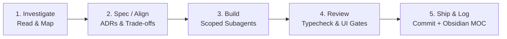

# Van

**Design-engineered full-stack developer and agentic workflow builder.**  
I bridge Swiss-minimalist visual design systems with pragmatic software engineering—using spec-first alignment and custom multi-agent pipelines to ship production applications with strict code and UI discipline.

> **Currently Building:** Multi-app retail POS, B2B receivables, and e-commerce systems (`Next.js 15` + `Prisma` + `PostgreSQL`) alongside autonomous agentic tooling.

---

## Selected Systems

| System | Scope | Core Stack |
| :--- | :--- | :--- |
| **KJE Store Management & E-Kiosk** | Multi-app retail POS, shift Z-reading audits, inventory control, B2B charge invoicing & Credit PINs, regional truck logistics, and e-commerce storefront | `Next.js 15`, `TypeScript`, `Prisma`, `PostgreSQL`, `Turborepo`, `HitPay` / `Xendit` / `PayMongo`, `Cloudflare R2`, `Heroku` |
| **vanPf** | Monochromatic Swiss-minimalist engineering portfolio powered by a custom zero-dependency WebGL2 topographic contour shader | `TypeScript`, `React`, `WebGL2`, `GLSL`, `Tailwind CSS` |
| **Autonomous Agent Pipeline & Second Brain** | Custom multi-agent finalizer CLI, anti-AI-slop UI linter, lifecycle hooks, and structured PARA/ADR engineering memory | `Node.js`, `Antigravity IDE`, `Cursor IDE`, `MCP`, `Obsidian` |
<!-- | **Roots2Restaurant** | B2B agricultural marketplace with real-time order-in-chat, atomic stock deduction, POS checkout, and AI kitchen assistant | `Next.js`, `TypeScript`, `Supabase`, `PayMongo`, `Gemini API` |-->

---

## How I Build with Agents

- **Spec-First Alignment**: Resolve branching architectural and UX decisions interactively before writing code, documenting trade-offs as Architecture Decision Records (ADRs).
- **Multi-Agent Orchestration**: Run a 5-stage pipeline (`Investigate -> Build -> Review -> Commit -> Log`) with scoped subagent roles, isolated git branch execution, and self-healing retry loops.
- **Enforced Quality & Design Gates**: Pair pragmatic YAGNI engineering with automated anti-AI-slop UI linting, modular component ceilings, and native zero-dependency solutions where libraries add bloat.
- **Persistent Second Brain**: Maintain an Obsidian knowledge base (PARA + MOC) wired to MCP and automated session logging so specs, runbooks, and patterns carry across projects.

---

## Stack & Tooling

**Engineering**  

**Infrastructure & Payments**  

**Agentic, Knowledge & Design**  

---

## GitHub Activity

  
  

---

IT student open to engineering roles and collaborations · [Portfolio](https://vanrcg.tech) · [Email](mailto:markyvan24@gmail.com)
